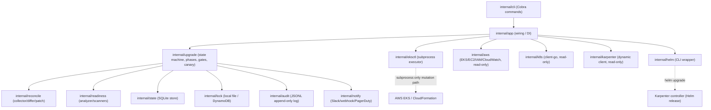

# eks-upgrader

A CLI based Amazon EKS upgrade tool that safely upgrades EKS clusters using
`eksctl` as the only tool that mutates EKS and CloudFormation resources. `eks-upgrader`
owns sequencing, policy enforcement, state, live-state reconciliation, upgrade
readiness analysis, canary validation, approval workflows, audit, and notifications —
it never calls AWS EKS mutation APIs directly and never silently rewrites
`cluster.yaml`.

> **Status: not yet validated against a real AWS EKS cluster.** The full test suite
> (unit + integration) passes, and the CLI has been exercised end-to-end against
> [floci](https://github.com/floci)/LocalStack-compatible emulated AWS APIs (EKS, EC2,
> IAM, CloudWatch, DynamoDB) — see `internal/*/integration_test.go` — but emulated EKS
> is not a substitute for real control-plane/CloudFormation behavior, real `eksctl`
> timing, or a real Karpenter/Kubernetes cluster. **Do not point this at a production
> cluster without first dry-running and testing thoroughly against a disposable/
> non-production EKS cluster.**

## What it does

- Upgrades the EKS control plane, EKS-managed add-ons (VPC CNI, CoreDNS, kube-proxy),
  the Karpenter controller (via Helm), and managed node groups (strictly sequential,
  one minor version at a time) through a fixed, checkpointed, resumable state machine.
- Pulls and diffs live cluster/Karpenter state against Git-declared desired state
  before ever touching anything (`state pull` / `state diff` / `validate
  --use-live-state`).
- Runs an Upgrade Readiness Analyzer (EKS Upgrade Insights, deprecated-API detection,
  Karpenter/add-on compatibility, capacity/PDB/node checks) and refuses to proceed past
  approval unless the result is `READY` or `READY_WITH_WARNINGS`.
- Evaluates per-node-group health gates and Prometheus-based canary checks between
  every node-group rollout.
- Supports pause/resume/abort, an approval gate for the control-plane mutation, a
  resume circuit breaker, graceful SIGINT/SIGTERM handling, a distributed lock
  (local file or DynamoDB), immutable JSONL audit events, and Slack/webhook/PagerDuty
  notifications.
- Generates (never applies) a Git patch proposing `cluster.yaml`/Karpenter manifest
  updates after a successful run — a human always reviews and merges it.

## Architecture



Every external system (eksctl, AWS, Kubernetes, Karpenter, Helm, Prometheus) sits
behind a narrow interface implemented once in `internal/app` and faked everywhere
else, so the orchestration engine (`internal/upgrade`) is fully unit-testable without
any live infrastructure. The fixed phase sequence, failure-transition table, resume
re-verification, and resume circuit breaker all live in `internal/upgrade` and are
driven entirely through the `Dependencies` interface. See
[docs/architecture.md](docs/architecture.md) for the full component breakdown,
state-machine diagram, and config-ownership/eksctl-boundary details.

## Design philosophy

- **Git is the source of truth.** `eks-upgrader` never writes to `cluster.yaml`,
  Karpenter manifests, or `upgrade.yaml`. A successful run proposes a patch
  (`output/cluster.patch`, `output/karpenter.patch`); a human always reviews and
  merges it.
- **eksctl is the only mutation path.** All EKS control-plane, managed-node-group, and
  CloudFormation mutations go through `eksctl` as a subprocess — never a direct AWS
  EKS mutation API call. Every invocation is logged with full args, exit code,
  duration, and a context timeout.
- **Karpenter owns node lifecycle.** `eks-upgrader` reads `NodePool`/`EC2NodeClass`/
  `NodeClaim` state but never patches it directly; AMI/disruption-budget changes are
  proposed as a Git patch, and Karpenter's own drift reconciliation does the actual
  node replacement.
- **eks-upgrader only orchestrates.** Sequencing, policy enforcement, state,
  validation, canary evaluation, audit, and notifications — not infrastructure
  mutation — are its job.
- **Fail closed.** If a required safeguard (readiness, PDBs, node health, a resume
  re-verification, etc.) can't be positively verified, the run pauses or aborts rather
  than proceeding optimistically.
- **One minor version at a time, every phase resumable.** Skipping Kubernetes minor
  versions is rejected at validation time; every phase transition is checkpointed to
  SQLite so a crash or interruption is always resumable, never a silent corruption.
- **No secrets, no hardcoded identifiers, in YAML.** Credentials/webhooks/tokens are
  environment-variable *names* only; cluster names, account IDs, regions, and AMI IDs
  come from the YAML inputs or AWS, never literals baked into the code.

## Installation

```bash
git clone <this-repo>
cd eks-upgrader
make build          # -> bin/eks-upgrader
# or
make docker          # -> eks-upgrader:<version> image (bundles eksctl/helm/kubectl)
```

Requires Go 1.23+ to build from source. At runtime, `eksctl`, `helm`, and `kubectl`
must be on `$PATH` (or pointed to via `--eksctl-path`/`--helm-path`); `pluto` and
`kubent` are optional (deprecated-API scanning degrades gracefully if absent).

## Prerequisites

- An existing EKS cluster managed by an eksctl `ClusterConfig` (`cluster.yaml`).
- AWS credentials (IAM role, IRSA, or CI OIDC — never static keys in config) with at
  least the permissions in [docs/iam-policy.md](docs/iam-policy.md).
- A kubeconfig with read access to the cluster (for node/pod/PDB/Karpenter checks).
- `eksctl`, `helm`, `kubectl` installed; see `scripts/install-tools.sh`.
- Secrets for notifications/canary (`SLACK_WEBHOOK_URL`, `PAGERDUTY_ROUTING_KEY`,
  `PROMETHEUS_TOKEN`, etc.) exported as environment variables — never placed in YAML.

## Quickstart

```bash
# 1. Validate structurally, then against live cluster state
eks-upgrader validate --plan upgrade.yaml --cluster-config cluster.yaml --use-live-state

# 2. Check upgrade readiness (deprecated APIs, EKS Insights, Karpenter/add-on compat)
eks-upgrader readiness --plan upgrade.yaml --cluster-config cluster.yaml \
  --target-version 1.31 --output ./output

# 3. See exactly what would run, with zero mutation
eks-upgrader upgrade --plan upgrade.yaml --cluster-config cluster.yaml --dry-run

# 4. Run it
eks-upgrader upgrade --plan upgrade.yaml --cluster-config cluster.yaml

# ...if it pauses for approval, from another session:
eks-upgrader approve --state ./state/upgrade.db --approver "you" --comment "approved"
eks-upgrader resume --plan upgrade.yaml --state ./state/upgrade.db

# Anytime:
eks-upgrader status --state ./state/upgrade.db
eks-upgrader report --state ./state/upgrade.db --format markdown
```

See [configs/examples](configs/examples) for complete `cluster.yaml`/`upgrade.yaml`
examples and [docs/yaml-reference.md](docs/yaml-reference.md) for every field.

## CLI reference

| Command | Mutates? | Purpose |
|---|---|---|
| `validate --plan --cluster-config [--use-live-state]` | no | structural + (optionally) live-state validation |
| `state pull --cluster --region --output` | no | snapshot live EKS/Karpenter state to `output/observed-cluster.yaml` |
| `state diff --cluster-config --observed [--karpenter-config]` | no | classify drift between Git and a previously pulled snapshot |
| `readiness --plan --cluster-config [--target-version] --output` | no | full Upgrade Readiness Analyzer report |
| `upgrade --plan --cluster-config [--dry-run]` | yes (unless `--dry-run`) | run the state machine |
| `resume --plan --state [--force]` | yes | continue a paused/interrupted run |
| `status --state` | no | current phase, progress, next action |
| `report --state --format json\|yaml\|markdown` | no | full run report |
| `pause --state --reason` | no | operator-initiated pause at the next safe checkpoint |
| `abort --state --reason` | releases lock | mark a run aborted, release its lock, notify |
| `approve --state --approver --comment` | no | record approval, allow a paused control-plane upgrade to proceed on next resume |
| `lock release --cluster --region --confirm` | releases lock | forcibly release a stuck lock (only when no run is actually active) |
| `version` | no | build version info |

Every command accepts `--log-level`, `--log-format=json\|text`, and `--timeout`.

### Exit codes

`0` success/ready · `1` warnings present · `2` blocking findings · `3` internal/unexpected error.

## Security model

- No AWS credentials, Slack tokens, webhook URLs, or PagerDuty keys are ever read from
  YAML — only environment variable **names** (`*Env` fields), resolved at send time.
  `validate` scans for literal secret material (AWS access keys, Slack webhook URLs/
  tokens, PEM private keys) and fails closed if any are found.
- `eks-upgrader` calls read-only AWS/Kubernetes APIs directly; all EKS/CloudFormation
  **mutation** goes through `eksctl` as a subprocess, with full argument/exit-code/
  duration logging and a context timeout on every invocation.
- Karpenter `EC2NodeClass`/`NodePool` objects are read-only from `eks-upgrader`'s
  perspective; AMI/disruption-budget drift is proposed as a Git patch, never written
  directly to the live objects.
- State (SQLite) and audit logs (append-only JSONL) are local files; secure them with
  filesystem permissions appropriate to your environment (the container runs as a
  non-root user by default).
- See [docs/iam-policy.md](docs/iam-policy.md) for the minimum IAM policy.

## Limitations

- **Not yet validated against a real AWS EKS cluster or a real Karpenter/Kubernetes
  installation.** Testing so far is unit/integration tests plus end-to-end CLI runs
  against emulated AWS APIs (floci/LocalStack); real `eksctl` CloudFormation timing,
  real EKS control-plane upgrade behavior, and real Karpenter drift reconciliation
  have not been exercised. Treat every phase's behavior as unverified until you've
  run it against a disposable test cluster end to end.
- `spec.preflight.minAvailableIPsPerSubnet`/`requireSubnetCapacity` are reserved:
  `cluster.yaml`'s schema does not currently model subnet IDs, so subnet-IP capacity
  checks are a no-op until that's supplied out-of-band.
- `spec.canary.comparisonMode: baseline` (control-group comparison) is schema-only;
  only absolute-threshold canary evaluation is implemented.
- `spec.postUpgrade.verifyIngress/verifyDNS/verifyPVCs` and `runSmokeTests` are
  reserved; only node-readiness/pending-pod/PDB checks are implemented in
  `POST_UPGRADE_CHECK` today.
- Blue/green node-group creation/cutover is documented guidance
  (`docs/fallback-runbook.md`) plus a naming helper, not yet a fully automated phase.
- Pluto/kubent are invoked as external CLI binaries and skipped (not failed) when
  absent; they are supplementary signals, not the sole deprecated-API detector.
- The local file-based lock backend is safe for a single host/CI runner only; use
  `lock.backend: dynamodb` for safety across concurrent CI runners.
