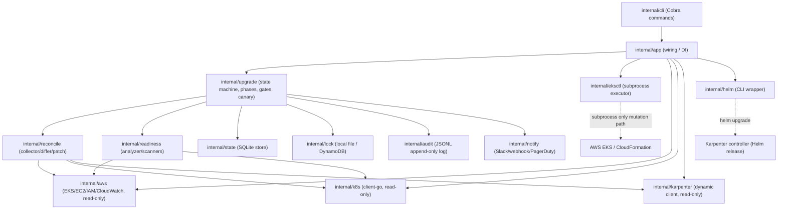

# Architecture

## Component diagram



## State machine

`internal/upgrade/statemachine.go` defines the fixed phase sequence:

```
INIT -> VALIDATE -> STATE_RECONCILIATION -> READINESS_ANALYSIS -> PREFLIGHT -> APPROVAL
     -> CONTROL_PLANE_UPGRADE -> ADDON_UPGRADE -> KARPENTER_UPGRADE -> NODE_GROUP_UPGRADE
     -> POST_UPGRADE_CHECK -> CONFIG_RECONCILIATION -> COMPLETE
```

`CANARY` is not a top-level phase: canary checks are an embedded sub-step inside
`NODE_GROUP_UPGRADE` (after each node group) and `POST_UPGRADE_CHECK`. A canary failure
fails the enclosing phase.

Failure transitions are resolved by `FailureAction` in `statemachine.go`, combining a
fixed per-phase default (e.g. `VALIDATE` failure is always `FAILED`, `READINESS_ANALYSIS`
blocking findings always `ABORTED`) with the plan's `spec.fallback.*` policy for phases
where the operator can choose pause-vs-abort.

Every phase transition, approval, eksctl command, node-group status change, and resume
attempt is persisted to the SQLite state store (`internal/state`), which runs in WAL
mode so `status`/`report` can read concurrently with an active `upgrade`/`resume`
process. `resume` re-verifies live state for the in-flight phase (`Dependencies.
AlreadySucceeded`) before retrying a mutating command, and a per-phase resume counter
acts as a circuit breaker (default max 3 attempts, overridable with `--force`).

## Config ownership

- **Git** (`cluster.yaml`, `upgrade.yaml`, Karpenter manifests) is the source of truth
  for desired state. `eks-upgrader` never writes to these files; `CONFIG_RECONCILIATION`
  only ever produces a unified diff (`output/cluster.patch`, `output/karpenter.patch`)
  for a human to review and `git apply`.
- **eksctl** owns all EKS control-plane, managed-node-group, and CloudFormation
  mutations (`internal/eksctl`, invoked only as a subprocess).
- **Karpenter** owns elastic node lifecycle and drift-based replacement. Its controller
  is upgraded via Helm (`internal/helm`); `EC2NodeClass`/`NodePool` objects are read-only
  from `eks-upgrader`'s perspective — AMI/disruption-budget changes are proposed as a
  Git patch, never written directly to the live objects.
- **eks-upgrader** owns orchestration, policy enforcement, sequencing, state, approval
  gating, canary evaluation, audit, and notifications.

## eksctl boundary

`internal/eksctl.SubprocessExecutor` is the only code path that invokes `eksctl`.
`InstrumentedExecutor` wraps it with a per-command context timeout, structured
logging, an audit event before/after, and a persisted `state.EksctlCommandRecord`
(full args, exit code, duration, stdout/stderr). Command argument construction
(`cluster.go`, `nodegroup.go`, `addons.go`) is pure and unit-tested independently of
subprocess execution; `internal/eksctl/mocks.FakeExecutor` lets the rest of the
codebase be tested without a real `eksctl` binary.

## Karpenter integration

`internal/karpenter` talks to the cluster via the Kubernetes dynamic client (no
vendored Karpenter API types), covering `NodePool`, `EC2NodeClass`, and `NodeClaim`.
`internal/karpenter/disruption.go` is pure logic (no cluster access) that evaluates
which configured disruption budgets are currently active (including cron-scheduled
windows) and computes the most restrictive node-count allowance — used both for
preflight validation and for live-state drift detection.

## State reconciliation design

`internal/reconcile.Collector` aggregates read-only state from the narrow `EKSReader`,
`NodeGroupNodesReader`, and `KarpenterReader` interfaces (satisfied by the real AWS/
Kubernetes/Karpenter clients, or by fakes in tests) into a single `ObservedCluster`
snapshot. `differ.go` classifies every difference between Git-declared desired state
and the snapshot as `IN_SYNC` / `INFO` / `WARNING` / `BLOCKING` / `UNMANAGED`;
`normalizer.go` (`ApplyPolicy`) then reconciles that default classification against the
plan's `stateReconciliation.{ignoredFields,warnOnlyOn,blockOn}` lists (which support a
`[*]` wildcard segment, e.g. `managedNodeGroups[*].kubernetesVersion`).

## Readiness analyzer design

`internal/readiness` aggregates independent signals into readiness `Finding`s with a
severity (`SAFE`/`WARNING`/`BLOCKING`), then `ComputeStatus` derives the overall
`READY` / `READY_WITH_WARNINGS` / `NOT_READY` verdict:

- `insights.go` classifies `aws eks list-insights` results per policy.
- `deprecated_apis.go` classifies raw findings from `internal/readiness/scanners`
  (a direct `apiserver_requested_deprecated_apis` metrics scrape, plus optional
  external `pluto`/`kubent` invocations that degrade gracefully to "skipped" if the
  binary isn't installed).
- `compatibility.go` checks Karpenter controller version against a maintained minimum
  table, and emits an informational reminder (not a fabricated matrix) for EKS add-on
  compatibility.
- `capacity.go` wraps node-readiness, pending-pod, PDB, and subnet-IP checks.

See [readiness-checks.md](readiness-checks.md) for the full severity policy.
